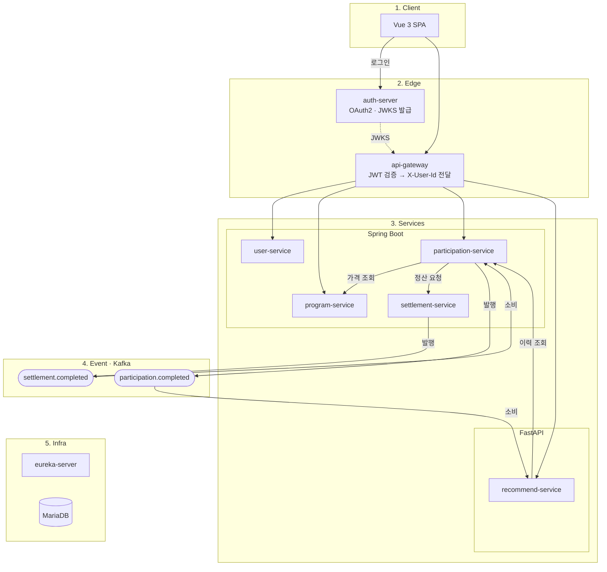

# LocalLink — 지역 공동물류 플랫폼 (MSA)

지자체 담당자가 공동물류 프로그램을 개설하고 소상공인이 참여 신청·정산을 하는 B2G2B 플랫폼.
Spring Cloud 도메인 서비스 4개 + FastAPI 추천 서비스로 구성한 MSA.

**SKALA MSA 팀 프로젝트 → 개인 확장**

---

## Overview

- **Objective** : 참여 신청 → 정산 → 참여 확정 흐름을 서비스 간 REST + Kafka 이벤트로 처리
- **Method** : MSA (Eureka, API Gateway, OAuth2/JWT) + 이벤트 기반 상태 변경 (PENDING → ACTIVE)
- **Tools** : Docker Compose(컨테이너 10개), Kafka, MariaDB

## Features

- 신청 API는 바로 `PENDING` 응답, `ACTIVE` 변경은 `settlement.completed` 이벤트 수신 후 처리
- 정산 요청 결과를 확실한 실패 / 결과 불명(타임아웃·5xx)으로 나눠 처리, 늦게 온 이벤트로 복구
- 조건부 UPDATE로 같은 이벤트 중복·동시 수신 시 부수효과 1회
- 서비스 간 `/internal/**` 토큰 보호, 내부 서비스 포트 비공개, 헤더 위조 차단
- 추천 서비스 장애 시 인기순·빈 목록으로 대체 응답 (마이페이지 유지)
- MariaDB·Eureka 없이 서비스별 `./gradlew test`, `pytest` 실행

## Tech Stack

- **Backend** : Java 21, Spring Boot 3.4, Spring Cloud(Eureka, Gateway), Spring Security OAuth2, JPA
- **Messaging** : Kafka (`settlement.completed`, `participation.completed`)
- **Recommend** : Python, FastAPI, httpx, python-jose
- **Frontend** : Vue 3, Pinia, Vite
- **Infra** : Docker Compose, Nginx, MariaDB
- **Test** : JUnit 5, MockMvc, EmbeddedKafka, H2, pytest

---

## Services

| 서비스 | 역할 |
|---|---|
| `user-service` | 사용자·역할 (`MERCHANT`, `GOV_OFFICER`) |
| `program-service` | 공동물류 프로그램, 가격·카테고리·참여 건수 |
| `participation-service` | 참여 신청, 상태 변경, program·settlement 호출 |
| `settlement-service` | 정산 후 `settlement.completed` 발행 |
| `recommend-service` | 규칙 기반 추천 (FastAPI), 자체 JWT 검증 |

## Architecture



---

## Getting Started

```bash
cp .env.example .env          # DB 비밀번호, INTERNAL_API_TOKEN 변경
docker compose up -d --build  # auth-server, api-gateway 는 msa-lecture/*:1.0 이미지가 로컬에 있어야 함

cd vue-frontend && npm install && npm run dev   # http://localhost:3000 (→ gateway :8080 프록시)
```

| 주소 | 용도 |
|---|---|
| `localhost:8080` | API Gateway |
| `localhost:9000` | auth-server |
| `localhost:8761` | Eureka 대시보드 |

테스트 (MariaDB·Eureka·Kafka 불필요):

```bash
cd participation-service && ./gradlew test   # program / settlement / user-service 동일
cd recommend-service && pip install -r requirements-dev.txt && pytest
```

상세 흐름: [정산 흐름 백엔드 코드 서술](./정산_흐름_백엔드_코드_서술.md)

---

## Troubleshooting

| 단계 | 문제 | 해결 | 드러나는 역량 |
|---|---|---|---|
| 팀 | 신청 후 계속 "대기중" 표시 (상태 변경이 이벤트로 늦게 일어나고 화면에 알릴 방법 없음, 백엔드 수정 불가) | PENDING일 때만 3초 폴링(최대 8~10회), ACTIVE 시 중단, 단계 표시, 수동 재확인 버튼, 이탈 시 타이머 정리 | 비동기 구조에서 원인 파악, 제약 안에서 해결 |
| 팀 | 추천 API 실패 시 마이페이지 전체 깨짐 | timeout 5초, 이력 조회 실패 → 인기순, 목록 실패 → 빈 목록 | 장애 범위 제한 |
| 개인 | 카테고리가 API마다 enum / 한글 라벨로 다르게 옴 (백엔드는 강의 플랫폼 이름, 프론트에서만 변환) | 서비스명·REST·DB·토픽을 program / participation / settlement로 통일, 마이그레이션 SQL 제공 | 조건이 바뀌면 이전 결정 다시 보기 |
| 개인 | 정산 실패 후 재신청 불가, 타임아웃을 실패로 처리하면 "정산됨 + 참여 실패" 불일치 | 확실한 실패 → FAILED(재신청 시 복구), 타임아웃·5xx → PENDING 유지 후 이벤트 또는 10분 뒤 정리, 늦은 이벤트 → ACTIVE 복구 | 실패와 "결과 모름" 구분 |
| 개인 | 같은 이벤트 재수신 시 참여 건수 중복 증가 | `UPDATE ... WHERE status = ...`로 실제 바뀐 경우만 후속 처리, 동시 8건 → 1회 테스트 | 동시성·중복 처리 |
| 개인 | 서비스 포트로 직접 요청 시 `X-User-Id` 위조 가능, `/internal/**` 노출 | 내부 토큰 검사, 포트 비공개, 공개 경로 GET만 허용·헤더 제거, 등록은 `GOV_OFFICER`만 | 보안 빈틈 직접 찾아 막기 |
| 개인 | 모든 신청 금액이 99,000원 고정 | program-service에서 실제 가격 조회, 0 이하 거부 | 데이터 소유 서비스 구분 |

## Limitations

- DB 커밋과 Kafka 발행이 분리되어 이벤트 누락 가능 → Outbox
- 컨슈머 예외를 로그만 남김 → 재시도·DLQ
- 서비스 4개가 DB 하나 공유 → 서비스별 DB 분리
- 고정 내부 토큰, 프론트 번들에 client secret 포함 → client-credentials, PKCE
- 상태 변경을 서버가 알려주지 않아 폴링 → SSE
- H2로만 테스트, E2E 없음 → Testcontainers

---

## Contributors

| 단계 | 담당 |
|---|---|
| 1단계 (팀) | 추천 서비스(FastAPI, 장애 대체 응답), 프론트 신청 상태 폴링 |
| 2단계 (개인) | 도메인 용어 통일, 정산 실패 처리, 이벤트 중복 처리, 내부 API 보호, 정산 금액 조회, 테스트 |
